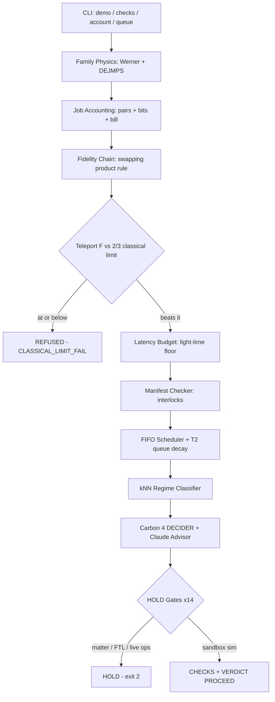
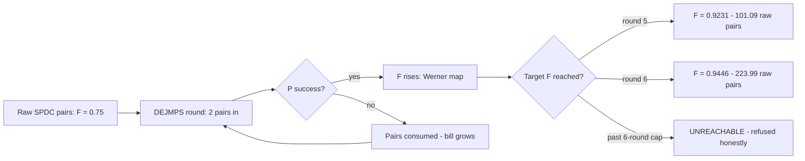
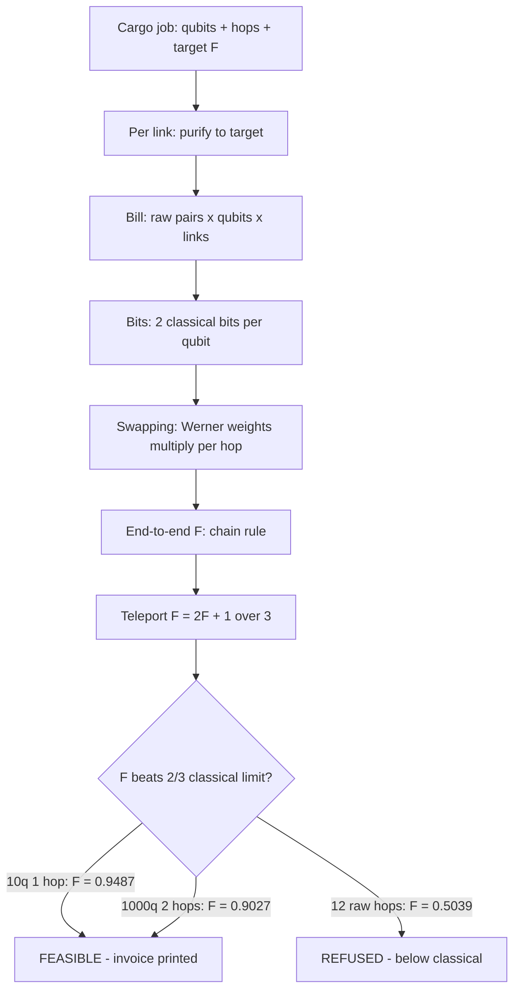
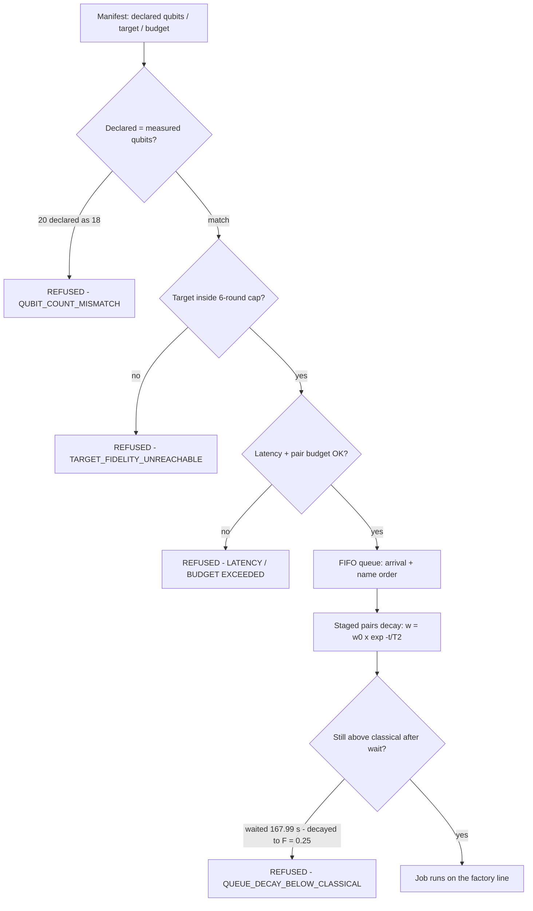
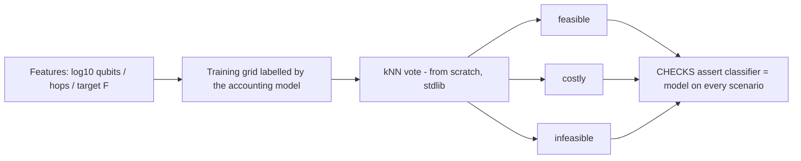
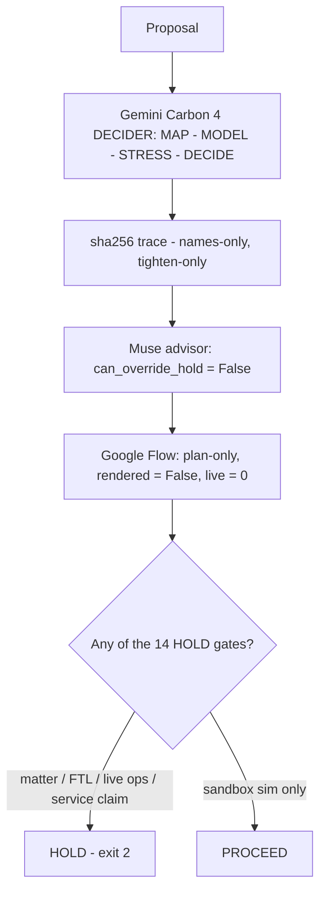
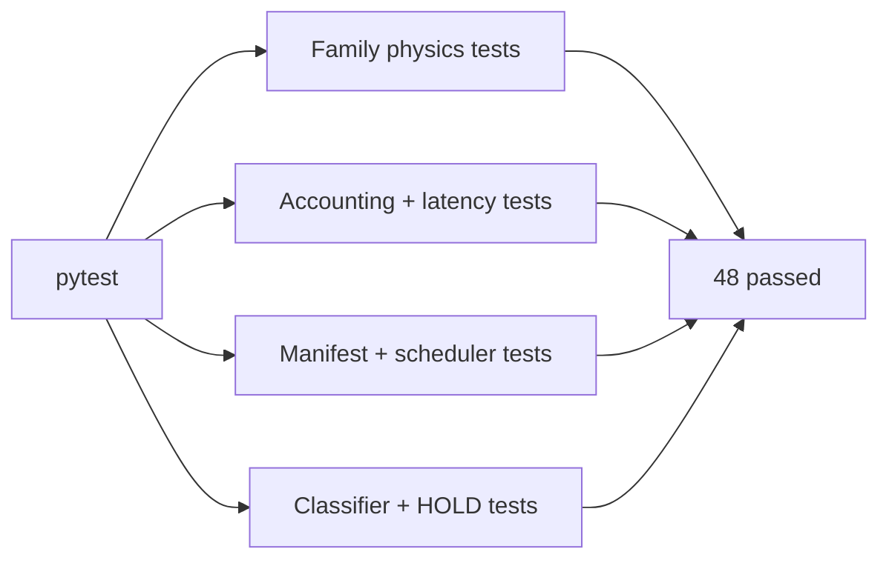
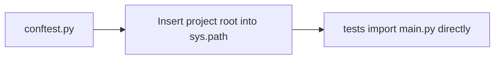
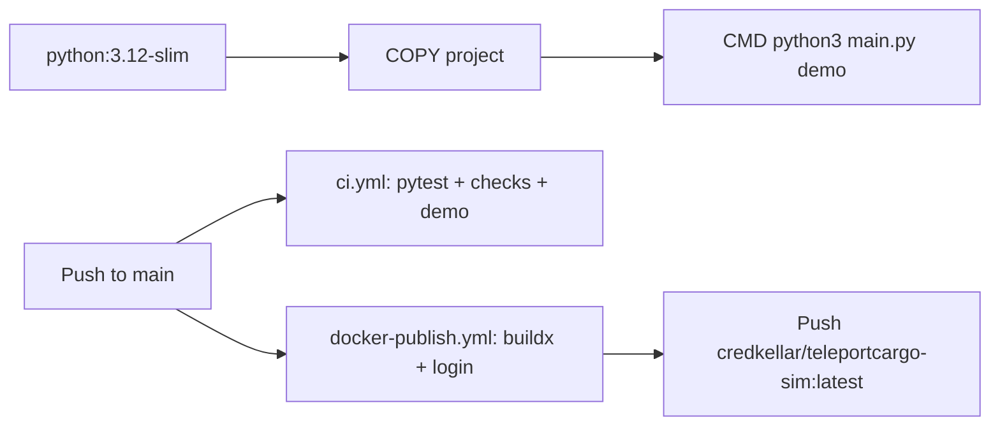

# TeleportCargo-Sim 📦⚛️

**Quantum Teleportation Cargo Simulator** — by Darion Kellar

TeleportCargo-Sim is an **educational teleportation resource-accounting lab** in ONE pure-Python file — the cargo desk above the family stack:

- **EntangleNet-Q** = the physics layer: the Werner pair model and teleportation formulas, simulation-verified. ⚛️
- **BellPair-Factory** = the supply layer: raw SPDC pairs at F = 0.75 off `spdc-line-a` at 1,200 pairs/s. 🏭
- **TeleportNet-Router** = the routing layer: relay hops and entanglement swapping. 🛰️
- **TeleportCargo-Sim** = the desk on top: it prices "cargo jobs" — teleporting the quantum state of a payload register — and refuses the ones whose numbers do not work. 📦

The pricing is real family physics, reused unchanged: **Werner pairs** F = (1 + 3w)/4, **DEJMPS purification** billed in raw pairs, **entanglement swapping** by the Werner-weight product rule, teleport output fidelity **(2F + 1)/3** judged against the **2/3 classical limit**, a **light-speed latency budget**, a **manifest checker** with named refusal reasons, a deterministic **FIFO scheduler** whose queue decays (memory T2), and a from-scratch **kNN regime classifier**.

Honest scope, stated up front: **teleportation moves quantum STATE information only — never matter, never mass, never faster than light.** The classical channel is mandatory and light-speed-limited, rebuilding anything physical at the far end needs local matter there, and macroscopic matter teleportation is not possible with known physics. This lab operates **nothing real**: no pair sources, no repeaters, no network. Every matter / FTL / live-operation / commercial-cargo claim sits behind a permanent HOLD gate (14 total). 🔒

[](https://github.com/kimanicollier44-cmyk/TeleportCargo-Sim/actions/workflows/ci.yml)
[](https://github.com/kimanicollier44-cmyk/TeleportCargo-Sim/actions/workflows/docker-publish.yml)

> ℹ️ These are the **live** workflow badges for this repo. They activate as soon as the `ci.yml` and `docker-publish.yml` files from the paste pack are pasted into `.github/workflows/` — until then they have nothing to report yet.

## 🧰 Tech Stack Badges & Full Architecture Tech Stack

### 💻 Core Programming Languages & Core Systems


- 🐍 Python 3.12, pure standard library (`math`, `hashlib`, `json`, `sys`) — zero dependencies, zero network, deterministic (double-run byte-identical) — ONE file: `main.py`
- ⚛️ Quantum core: Werner-state pair model F = (1 + 3w)/4, DEJMPS purification map + success probability, swapping product rule, teleport fidelity (2F + 1)/3, memory decay w(t) = w₀·exp(−t/T2) — formulas simulation-verified in EntangleNet-Q and reused unchanged across the family
- 🧮 Accounting engine: per-job pair bill (purification compounding 2/P_success per round, per link pair), classical-bit count, light-time latency floor, FIFO queue scheduler with decay refusals
- 🧠 TinyML kNN regime classifier (from scratch, stdlib) on (log₁₀ qubits, hops, target F), labels generated by the accounting model itself
- 🪑 Council seats: Gemini Carbon 4 DECIDER (names-only, tighten-only) + Muse advisor (never overrides HOLD) + Google Flow plan-only (rendered = False, live = 0)

### ⛓️ Web3 & Infrastructure

- 🚫 **Not applicable — honestly.** No blockchain, no Web3, no tokens: the "infrastructure" in this lab is a simulated quantum network — pair sources, relay hops, and a cargo desk — inside one offline file. No live network operation, ever (HOLD gate). No fake badges here.

### ⚙️ Platform Support & Hardware Architecture


- 🖥️ Pure Python — runs anywhere Python 3.12+ runs (Linux, macOS, Windows, any CPU architecture), plus the `python:3.12-slim` Docker image
- 🔒 No hardware is controlled, ever: real pair sources, repeaters, and quantum devices are permanent HOLD gates (see the gate table below)

### ⚡ Low-Level Infrastructure & Performance

- 🚫 **No low-level code — honestly.** No C, no C++, no GPU, no compiled extensions: this is one interpreted Python file on purpose, so every number can be read, checked, and diffed. Performance here means honest algorithms — closed-form family physics throughout, the only iteration being the DEJMPS round loop and the kNN sort — all deterministic and byte-identical between runs.

### 🛠️ DevOps & Build Tools


- 🐳 Docker (`python:3.12-slim`), GitHub Actions CI + Docker Publish (delivered in the paste pack)
- 🎯 Target image: `credkellar/teleportcargo-sim:latest`
- 🧪 Tests: `pytest` (48 tests) + the built-in CHECKS suite (60 checks) in `main.py`

### ☁️ Cloud Providers

- 🚫 **None — honestly.** No cloud provider is used or needed: the lab runs fully offline on your own machine or in a local Docker container. Docker Hub appears only as the registry the publish workflow pushes the image to.

## What this does?

1. 📜 **States the honest core, first and always** — teleportation moves quantum *state information* only: never matter, never mass, never faster than light. A "cargo job" here is teleporting the state of a payload register; rebuilding anything physical at the far end needs local matter there plus the state info, and macroscopic matter teleportation is not possible with known physics (HOLD gates, not footnotes).
2. 💱 **Prices every qubit exactly** — 1 Bell pair consumed + 2 classical bits per qubit, no exceptions, no bulk discounts. A 10-qubit sensor state costs 10 pairs and 20 bits before purification; a 1,000-qubit register costs 1,000 pairs and 2,000 bits before purification.
3. 🏭 **Bills purification like the factory does** — raw SPDC pairs at F = 0.75 (BellPair-Factory's spdc-line-a, 1,200 pairs/s) purified by DEJMPS: each round multiplies the expected raw-pair bill by 2/P_success. Five rounds reach F = 0.9231 at 101.09 raw pairs per delivered pair; six rounds reach the family's published F = 0.9446 at 223.99.
4. ⛓️ **Chains fidelity across relay hops** — swapping multiplies Werner weights, so end-to-end fidelity falls hop by hop: the sensor job's single hop delivers teleport F = 0.9487, while the 12-hop raw chain collapses to chain F = 0.2558 and teleport F = 0.5039.
5. ⚖️ **Judges against the classical limit** — teleport output (2F + 1)/3 must beat 2/3, the best any classical send can do. A pair at F = 0.5 lands exactly on 2/3; anything at or below is not quantum cargo, it is an expensive phone call — and the lab REFUSES it.
6. 💡 **Charges full light time** — the 2 classical bits per qubit ride an ordinary channel: Porter Ranch → Los Angeles 0.225 ms in fibre, LA → San Francisco 2.795 ms, Earth → Moon 1.2822 s in vacuum. No job's minimum latency ever beats its route's light time — asserted in the checks.
7. 🛂 **Checks the manifest like an interlock desk** — declared vs measured qubits, target fidelity reachable inside the 6-round cap?, latency inside the job's allowance?, raw-pair budget covering the bill? The worked book includes a manifest declaring 20 qubits as 18: REFUSED, `QUBIT_COUNT_MISMATCH`.
8. 🕐 **Schedules a deterministic FIFO queue** — one factory line, (arrival, name) order. While a job waits, its staged pairs decay with T2 = 1.0 s: the sensor job waits 167.99 s behind the register job, its pairs decay to the F = 0.25 floor, and it is REFUSED at the dock (`QUEUE_DECAY_BELOW_CLASSICAL`). Alone, the same job delivers.
9. 🧾 **Works the heavy example honestly** — the 1,000-qubit register over 2 hops: 202,186.54 raw pairs, 2,000 classical bits, 168.49 s of factory production, end-to-end teleport F = 0.9027. Feasible — and the invoice is printed, not hidden.
10. 🏷️ **Classifies regimes with TinyML** — a from-scratch kNN labels jobs `feasible` / `costly` / `infeasible` from (qubits, hops, target F); its training labels are generated by the accounting model itself, and the checks assert classifier and model agree on every scenario.
11. 🧠 **Advisory seats + checks** — Carbon 4 DECIDER with sha256 trace, Muse advisor, Google Flow plan-only, and a built-in CHECKS suite (60 checks).

## 🗺️ How it works — diagram per script

### `main.py` — the whole lab (master architecture)



### `main.py` — purification economics (DEJMPS)



### `main.py` — job accounting + fidelity chain



### `main.py` — manifest checker + FIFO scheduler



### `main.py` — kNN regime classifier



### `main.py` — council seats + HOLD gates



### `tests/test_main.py` — verification



### `conftest.py` — test path setup



### `Dockerfile` + CI flow — container & publish



## Why is this cool?

1. 🚫 It is the teleportation lab that refuses to lie to you: the first screen says what teleportation cannot do, and the math that follows never quietly takes it back.
2. 💱 The price of a qubit is exact and universal — 1 pair + 2 bits — so a "cargo manifest" becomes arithmetic you can audit, not science-fiction hand-waving.
3. 🏭 Purification economics compound like interest: F = 0.75 → 0.9446 costs 224 raw pairs per delivered pair, and the lab prints the whole compounding table.
4. ⛓️ The product rule is a cliff: twelve raw hops do not degrade the teleport gracefully, they drop it *below classical* — worse than just sending the bits.
5. ⚖️ The 2/3 classical limit is a bright line with a boundary case you can hold: a pair at F = 0.5 teleports at exactly 2/3, proven in the checks.
6. 💡 Light speed shows up as a line item, not a slogan: every job's latency floor is printed next to its pair bill, and the Moon route costs 1.2822 s no matter how good the pairs are.
7. 🕐 The queue is a physics problem: with T2 = 1.0 s memories, waiting 168 s behind a big job doesn't delay your pairs — it deletes them, and the scheduler says so.
8. 🛂 The manifest desk refuses paperwork the way real interlocks refuse overloads: misdeclare your qubit count and the job stops, with the reason named.
9. 🧾 It scales the invoice honestly from 10 qubits (1,010.93 raw pairs) to 1,000 (202,186.54) with the same formulas — no regime where the math changes its story.
10. 🎯 Deterministic end to end: run it twice, get byte-identical output — teleportation accounting you can diff.

## What problems this solves?

1. ❌ **Problem:** Pop-science teleportation implies matter beams across space instantly. ✅ **Solution:** The honest core is stated in the docstring, the demo's first section, and 14 HOLD gates: state information only, classical channel mandatory, light-speed floor charged on every job.
2. ❌ **Problem:** "Teleport a 1,000-qubit register" sounds free until someone prices it. ✅ **Solution:** The accounting engine prints the full bill — 202,186.54 raw pairs, 2,000 classical bits, 168.49 s of factory time — from the same DEJMPS economics as BellPair-Factory.
3. ❌ **Problem:** Relay chains get drawn as lossless lines on a slide. ✅ **Solution:** The Werner product rule computes the real end-to-end fidelity per hop count, and the 12-hop worked example collapses to 0.2558 in the open.
4. ❌ **Problem:** Jobs that can't beat a classical send still get called "quantum". ✅ **Solution:** Every job is judged against the 2/3 classical limit; at or below it, the verdict is REFUSED with `CLASSICAL_LIMIT_FAIL`.
5. ❌ **Problem:** Latency claims ignore the classical channel entirely. ✅ **Solution:** The latency budget charges one-way light time per route (fibre and vacuum) and the checks assert no job ever beats its own light time.
6. ❌ **Problem:** Manifest errors (wrong qubit counts, impossible targets) slip through as warnings. ✅ **Solution:** The manifest checker refuses with named reasons — `QUBIT_COUNT_MISMATCH`, `TARGET_FIDELITY_UNREACHABLE`, `LATENCY_EXCEEDED`, `PAIR_BUDGET_EXCEEDED`.
7. ❌ **Problem:** Queueing is treated as free storage for entangled pairs. ✅ **Solution:** The scheduler decays staged pairs with the family T2 model during every wait and refuses jobs that decay to the classical limit — backlog as decaying inventory.
8. ❌ **Problem:** Fidelity targets get promised beyond what purification can reach. ✅ **Solution:** `rounds_to_target` returns an honest "unreachable" past the 6-round cap (F = 0.999 never happens from 0.75), and the manifest desk enforces it.
9. ❌ **Problem:** Quantum-network numbers differ between every tool in the family. ✅ **Solution:** One physics layer, copied unchanged from EntangleNet-Q / BellPair-Factory / TeleportNet-Router — same Werner model, same DEJMPS map, same 0.9446-in-6-rounds headline, cross-checked in the tests.
10. ❌ **Problem:** Simulation tools quietly imply a real cargo service is near. ✅ **Solution:** Commercial-service, live-network, and guaranteed-delivery claims are permanent HOLD gates returning exit code 2; the lab is labelled educational simulation on every surface.

## How to install this?

1. 📋 Clone this repo:

```bash
git clone https://github.com/kimanicollier44-cmyk/TeleportCargo-Sim.git
cd TeleportCargo-Sim
```

2. 🐍 Make sure Python 3.12+ is installed: `python3 --version`
3. ▶️ Run the full demo + checks (no arguments needed):

```bash
python3 main.py
```

4. 🧪 Run the test suite:

```bash
pip install pytest
python3 -m pytest -q
```

5. 🎛️ Try the other commands:

```bash
python3 main.py checks    # 60 built-in checks
python3 main.py physics   # DEJMPS purification economics table as JSON
python3 main.py account   # worked cargo jobs: full resource accounting
python3 main.py latency   # light-time floors per route as JSON
python3 main.py manifest  # manifest checker verdicts for the job book
python3 main.py queue     # FIFO schedule with queue-decay verdicts
python3 main.py classify  # kNN regime verdicts
python3 main.py brains    # Carbon 4 + Muse + Flow seats
python3 main.py holds     # list all 14 HOLD gates
python3 main.py hold-demo # exits 2 - gated actions stay HOLD
```

6. 🐳 Or run it in Docker — pull the published image:

```bash
docker pull credkellar/teleportcargo-sim:latest
docker run --rm credkellar/teleportcargo-sim:latest
```

…or build it yourself:

```bash
docker build -t credkellar/teleportcargo-sim:latest .
docker run --rm credkellar/teleportcargo-sim:latest
```

## Requirements

- 🐍 Python 3.12 or newer
- 📦 Dependencies: **none** (standard library only)
- 🌐 Network: **none** — fully offline
- 🧪 For tests only: `pytest`
- 🐳 Optional: Docker

## FULL project structure tree

```text
teleportcargo-sim/
├── main.py                  # the whole lab: family physics, purification economics, latency budget, job accounting, manifest checker, FIFO scheduler, classifier, seats, HOLD gates
├── conftest.py              # puts the project root on sys.path for tests
├── tests/
│   └── test_main.py         # 48 pytest tests: physics, accounting, latency, manifest, scheduler, classifier, gates, determinism
├── assets/
│   └── cover.png            # README cover image (2736 x 912)
├── Dockerfile               # python:3.12-slim, runs the demo
├── .gitignore               # __pycache__/, .pytest_cache/, *.pyc
├── .github/
│   └── workflows/
│       ├── ci.yml           # paste-in (delivered in the workflow paste pack)
│       └── docker-publish.yml  # paste-in (delivered in the workflow paste pack)
└── README.md                # this file
```

> 📦 Delivered separately as paste packs: `.github/workflows/ci.yml` + `docker-publish.yml` (paste into `.github/workflows/`), and the Docker Hub pack (100-char description, 350-char About, overview, categories).

## 🔒 HOLD gates — all 14, permanent

| # | Gate | What stays held |
|---|------|-----------------|
| 1 | `matter_teleportation_claim` | Teleportation moves quantum state information only; no matter is ever transported |
| 2 | `mass_transport_claim` | No mass moves in teleportation; the payload register's state moves, its atoms stay home |
| 3 | `ftl_claim` | Nothing here is faster than light; the mandatory classical channel is light-speed-limited |
| 4 | `instant_delivery_claim` | No instant delivery: a teleport finishes no sooner than its classical bits arrive |
| 5 | `macroscopic_matter_claim` | Teleporting macroscopic matter is not possible with known physics |
| 6 | `human_teleportation_claim` | No teleporting people; a state description is not a person and no person is a payload |
| 7 | `living_cargo_claim` | No living cargo of any kind; this lab moves simulated qubit states only |
| 8 | `live_network_operation` | No operating any real quantum or classical network, ever |
| 9 | `commercial_cargo_service_claim` | No commercial cargo or teleportation service exists here; educational simulator |
| 10 | `real_hardware_control` | No control of any real pair source, repeater, or quantum hardware, ever |
| 11 | `live_experiment` | No live experiment instructions; this lab computes, it does not operate |
| 12 | `guaranteed_delivery_claim` | No guaranteed delivery or fidelity; every number is a labelled simulation result |
| 13 | `medical_claim` | No medical claims; simulated state transfer treats no condition |
| 14 | `weapons_application_claim` | No weapons application guidance of any kind |

🧑‍⚖️ **Council seats:** Gemini Carbon 4 Extended Thinking — DECIDER (names-only, tighten-only, MAP → MODEL → STRESS → DECIDE, sha256 trace, `can_override_hold = False`) · Muse — advisor (`can_override_hold = False`) · Google Flow — plan-only (`rendered = False`, `live = 0`).

✅ **Verification:** pytest **48 passed** (project + clean copy) · built-in CHECKS **60/60** · double-run output **byte-identical** · `hold-demo` exits **2** · `main.py` **831 lines**, pure stdlib, zero network.

## 🧒 5th-grade English section

Imagine you have a very special coin in Porter Ranch, and your friend in Los Angeles has its twin. 🪙

- The two coins are **linked** in a strange way — scientists call this entanglement. What happens to one is connected to the other.
- "Teleporting" the coin does **not** send the coin. Nobody's coin flies through the air. The metal stays exactly where it was. 🚫
- Instead, you do a careful measurement, and you send your friend a short **message** — just a few numbers — over an ordinary connection.
- Your friend uses those numbers to set their coin so it matches the *state* yours was in. The information travelled. The coin did not. ✉️
- The message cannot travel faster than light, so teleporting is **never instant** over long distances. Even to the Moon, the message needs more than a second. 🌙
- And your original coin's state is **used up** by the measurement — you cannot copy it and keep both. Teleporting moves the state; it never makes a spare.
- Real teleportation today works for tiny things like single particles of light. Teleporting a box, a cat, or a person is **not possible** — and this project will never pretend it is. 📦
- This project is a **pretend shipping desk on a computer**. It counts what teleporting information *would* cost — how many linked pairs, how many message bits, how long the wait — and it refuses jobs whose numbers do not work. 💻

---

MIT © 2026 Darion Kellar · TeleportCargo-Sim — educational simulation only 📦
